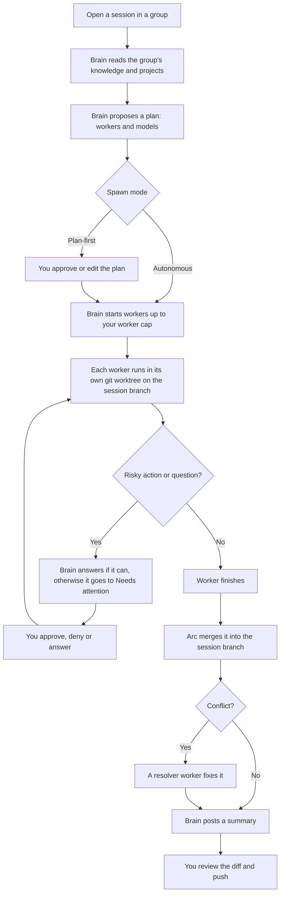

# Arc

Arc is a macOS desktop app for orchestrating coding agents across groups of projects. You organize project folders into named groups, and each group carries its own knowledge sections (notes, docs, playbooks, links, and custom sections) stored as plain files on disk, either inside the app's data folder or in a folder you link. Built with Electron, Svelte, and SQLite. Apple Silicon only.

Pre-release website: https://robedge.github.io/arc/ (source in [`website/`](website/README.md), a standalone pnpm project; pushes to `main` that touch `website/**` build it and deploy it to GitHub Pages through `.github/workflows/pages.yml`)

## What it does

- **Sessions with a brain and workers.** Ask a question or request a change across a group; a brain agent plans the work and starts workers, each in its own git worktree on a session branch, then merges their changes.
- **Three providers on your own subscriptions.** Agents run on the Claude Code, Codex and Cursor command-line tools already installed and signed in on your Mac. Choose a provider and model for the brain and the workers, or let Auto pick; Arc falls back to another provider when one isn't available. No API keys.
- **Approvals.** Risky actions (pushing, destructive commands, leaving the working copy) wait in Needs attention until you approve them.
- **Change review.** Review each session's diff file by file, leave notes, and push from Arc.
- **Stepping in.** Open any worker's terminal, ask it something, and hand it back.
- **Commands and skills.** Run your Claude Code, Codex and Cursor commands from the "/" list.
- **Usage.** Token counts per agent, plan usage meters, a Usage page and suggestions for cutting token spend.
- **Agent loading.** Choose which of your MCP servers, plugins, skills and hooks the brain and the workers load.

## How it works

Every session belongs to one group. Arc creates a session branch in each of the group's project repos, branching from `dev` (or from the repo's default branch when it has no `dev`). Workers never touch your working copy or each other's files: each one gets its own git worktree off the session branch, and Arc merges the finished work back. Arc never pushes on its own. You push from the change review.



1. You open a session and write a request. The brain reads the group's notes, docs and projects.
2. The brain proposes a plan that lists the workers it intends to start and the model for each. In Plan-first mode nothing runs until you approve it. In Autonomous mode the brain starts workers itself, up to a worker cap you set.
3. Workers run side by side. When one needs a permission it lacks, such as a push or a destructive command, or asks a question, the brain answers what it can. Anything else waits in Needs attention until you approve, deny or answer.
4. When a worker finishes, Arc merges its work into the session branch on its own, one worker at a time per repository. If two workers changed the same lines, a resolver worker settles the conflict. It asks you only when it isn't confident.
5. When all the work is merged, the brain posts a summary of what changed in each repository. You review the diff file by file and push the session branch.

## Development

Requires Node 22 or newer and pnpm 10.

```sh
pnpm install          # installs dependencies and prepares native modules for Electron
pnpm dev              # run the app with hot reload
pnpm test:unit        # Vitest, run under Electron's Node so one better-sqlite3 binary serves everything
pnpm test:e2e         # build, then Playwright-for-Electron
pnpm exec playwright test   # e2e against the existing build
pnpm lint
pnpm typecheck
pnpm format
pnpm package          # build and produce release/Arc-<version>-arm64.dmg and release/mac-arm64/Arc.app
```

Set `HARNESS_USER_DATA=<dir>` to keep the database, logs, and knowledge folders out of
`~/Library/Application Support/Arc`.

### Smoke check

After `pnpm package`, verify the packaged app can open its database and run migrations:

```sh
HARNESS_USER_DATA="$(mktemp -d)" release/mac-arm64/Arc.app/Contents/MacOS/Arc --smoke
echo $?   # 0 on success, non-zero on failure
```

## Releases

Every push to `main` (except ones that only touch `website/**`, `docs/**` or Markdown) runs
`.github/workflows/release.yml` on a `macos-14` runner. It runs `pnpm package` and publishes a
GitHub Release tagged `v<version>-build.<run number>`, marked latest, with generated notes. The dmg
is uploaded as `Arc-macos-arm64.dmg`, a stable name, so the newest build is always at
https://github.com/robedge/arc/releases/latest/download/Arc-macos-arm64.dmg (the website's
download button points there). Run it by hand from Actions > Release macOS build > Run workflow.

## Installing the .dmg

1. Download `Arc-macos-arm64.dmg` from the latest release, or open a local
   `release/Arc-<version>-arm64.dmg`, and drag Arc into Applications. and drag Arc into Applications.
2. Builds are ad hoc signed (no Apple Developer ID, no notarization). If you copied the app from
   another machine or downloaded it, macOS marks it as quarantined and Gatekeeper will refuse to
   open it. Clear the flag once:

   ```sh
   xattr -dr com.apple.quarantine /Applications/Arc.app
   ```

3. Launch Arc. Your data lives in `~/Library/Application Support/Arc` and logs in `~/Library/Logs/Arc`.

## Third-party fonts

Arc bundles Orbitron, Rajdhani and JetBrains Mono (through the `@fontsource` packages, pinned in
`package.json`). All three are licensed under the SIL Open Font License 1.1. The license text and
copyright lines are in `resources/licenses/FONTS-OFL.txt`, which is also copied into the packaged
app under `Contents/Resources/licenses/`.

## App icon

The icon sources are `resources/icon/arc-icon.svg` (full) and `arc-icon-small.svg` (16 to 64 px),
and the DMG background is `resources/dmg/background.svg`. After editing them, run `pnpm icons`
(macOS only) to regenerate the committed `resources/icon.icns`, `resources/icon.png` and
`resources/dmg/background.tiff`.
